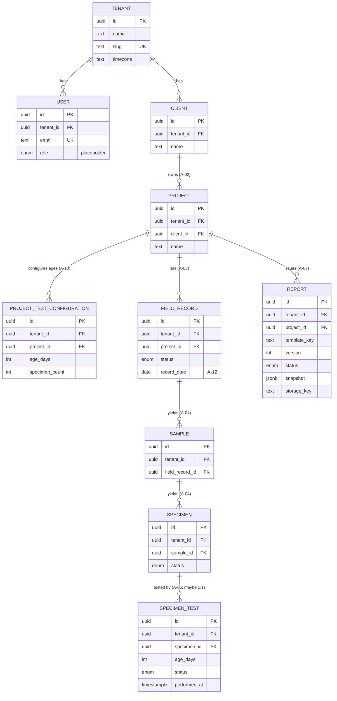

# Relationships & ERD

> Preliminary. Cardinalities marked with an assumption ID are unvalidated.

## ERD



Every table except `TENANT` also references `TENANT` directly through `tenant_id`.
Those edges are omitted from the diagram for readability.

## Tenant-safe foreign keys

Each parent declares `UNIQUE (id, tenant_id)`. Each child references the parent with
**both** columns:

```sql
ALTER TABLE samples
  ADD CONSTRAINT samples_field_record_fk
  FOREIGN KEY (field_record_id, tenant_id)
  REFERENCES field_records (id, tenant_id);
```

In Prisma:

```prisma
fieldRecord FieldRecord @relation(fields: [fieldRecordId, tenantId], references: [id, tenantId])
```

Effect: inserting a Sample with tenant A's `tenant_id` and tenant B's
`field_record_id` fails at the database level.

## Delete behaviour

| Relation | On delete | Why |
|----------|-----------|-----|
| Project → ProjectTestConfiguration | Cascade | Pure configuration, owned by the project |
| Everything else | Restrict (default) | Records are cancelled, not deleted (A-24). Prevents accidental loss of history. |

## Cardinalities to validate

| Relation | Current | Possible after validation | Question |
|----------|---------|---------------------------|----------|
| Project → Client | N:1 | N:M (owner + contractor + supervisor?) | Q-41 |
| FieldRecord → Project | N:1 | — | Q-04 |
| FieldRecord → truck/delivery | (fields TBD) | 1:N separate entity | Q-05 |
| Specimen → SpecimenTest | 1:N | 1:1 | Q-16 |
| Report → Project | N:1 | Report → FieldRecord(s) / date range | Q-31 |
| Age reference date | on FieldRecord | on Sample | Q-18 |
