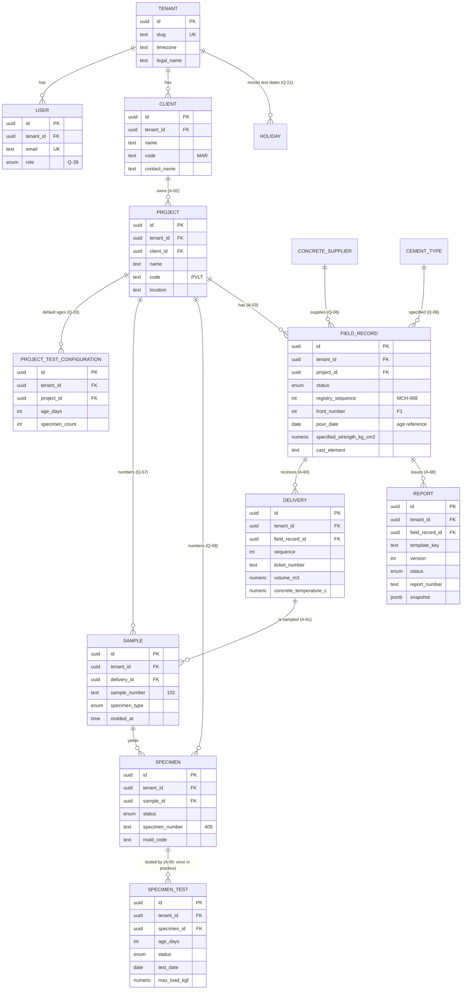

# Relationships & ERD

> Preliminary, based on the first lab documents ([../domain/analysis/](../domain/analysis/README.md)).
> Cardinalities marked with an assumption ID are unvalidated. Only key columns are shown;
> the full column list is in [schema.md](schema.md).

## ERD



Every table except `TENANT` also references `TENANT` directly through `tenant_id`.
Those edges are omitted from the diagram for readability.

## Tenant-safe foreign keys

Each parent declares `UNIQUE (id, tenant_id)`. Each child references the parent with
**both** columns:

```sql
ALTER TABLE samples
  ADD CONSTRAINT samples_delivery_fk
  FOREIGN KEY (delivery_id, tenant_id)
  REFERENCES deliveries (id, tenant_id);
```

In Prisma:

```prisma
delivery Delivery @relation(fields: [deliveryId, tenantId], references: [id, tenantId])
```

Effect: inserting a Sample with tenant A's `tenant_id` and tenant B's `delivery_id`
fails at the database level.

## Delete behaviour

| Relation | On delete | Why |
|----------|-----------|-----|
| Project → ProjectTestConfiguration | Cascade | Pure configuration, owned by the project |
| Everything else | Restrict (default) | Records are cancelled, not deleted (A-24). While a record is `DRAFT`, the service deletes its deliveries/samples/specimens explicitly. |

## Cardinalities to validate

| Relation | Current | Possible after validation | Question |
|----------|---------|---------------------------|----------|
| Project → Client | N:1 | — (confirmed, Q-41) | — |
| FieldRecord → Delivery | 1:N | — (7 per sheet, several sheets, Q-71/Q-77) | — |
| Delivery → Sample | 1:N | 1:1 | Q-71 |
| Specimen → SpecimenTest | 1:N | 1:1 (each specimen tested once, Q-16) | — |
| Report → FieldRecord | N:1 | — (confirmed: one page per sample, Q-71) | — |
| Test ages | project default + per-test edit | — (Q-20, Q-22) | — |
| Registro numbering | per project | per front | Q-79 |
